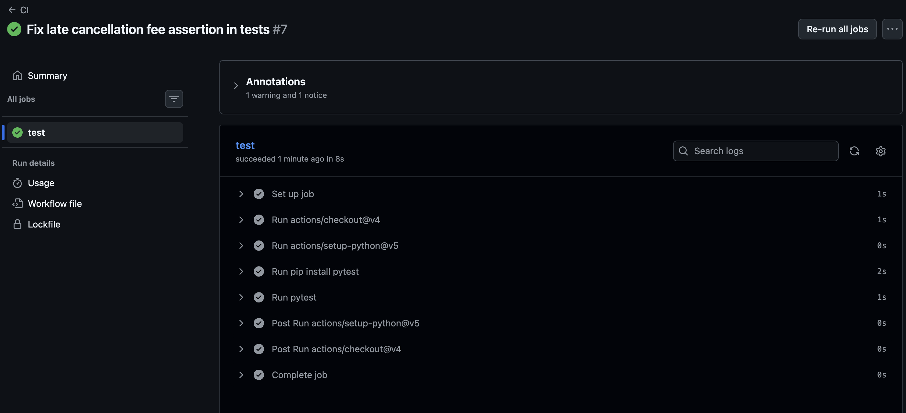
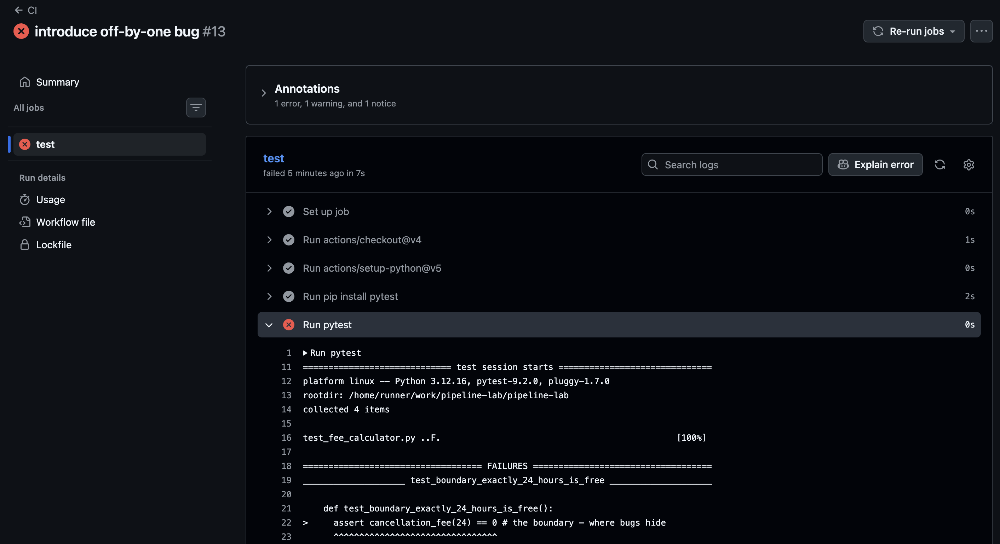

# pipeline-lab

**Part 2**

Green run screenshot: 
In one sentence: what event started this run, and who started it?
The definition in the ci yml file that defined that on push to the main branch kicked off this run. So it was started by me when I commited code to main.

**Part 3**

My prediction of which test would fail: test_boundary_exactly_24_hours_is_free() — was I right? yes
Red run screenshot: 
Green-again screenshot: 

In one sentence: what would this bug have cost if there were no pipeline?
If there were no pipeline, this error would have cost an end user a late fee if they had cancelled at the previous boundary. This would have cost the company time and money to reimburse the end use and resolve this issue and it would have caused a high severity and high priority bug causing the development team to reallocate their time.

**Part 4**

One improvement the AI suggested: AI added a PR on trigger, so that the pipeline fires on PR requests made to the main branch, not just pushes.
The gate in its version:

- name: Run tests # THE GATE: one failing test turns the whole run red
        run: pytest -ra --strict-markers

Would I merge its version? No, it adds many features that are not wanted or necessary such as concurrency, killing previous job if another is ran, and creates a fresh linux machine on each run.

**Reflection**

A pipeline that skips its tests is worse than no pipeline because it gives the illusion of gating and safety even though it is an empty promise. A lack of a pipeline adds manual opportunities to check the code quality and test, where as a pipeline with no testing is a direct flow of any code directly to a deployment. A red run teaches me that the test barricades work and when code changes, the testing actually enforces the code it is shipping. A green test does not reveal whether the testing actual enforces the code behavior. One rule I will follow is to always add a pytest to the ci yml file that dictates the workflow that is occuring. I have worked on pipelines in the past without unit testing checks, and I will not make that mistake going forward.
